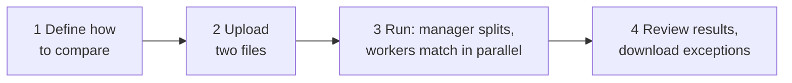

# reconArk

**reconArk compares two lists of transactions that should agree, such as a bank statement and a general ledger. It
finds what matches, what differs and what is missing, and explains every difference.** It is built from small,
replaceable parts ("Lego bricks"), and it scales by adding workers.



## Repository

| Folder | What's inside | Start with |
|---|---|---|
| [`docs/`](docs/README.md) | Design and documentation: business overview, C4 + HLD, LLD, developer, testing and operations guides, roadmap, decisions | [docs/README.md](docs/README.md) |
| [`code/`](code) | All source code | the table below |

| `code/` folder | What |
|---|---|
| `backend/common` | Business model and plugin interfaces (plain Java) |
| `backend/plugins` | Plugins: `format-csv`, `format-fixed-width`, `compare-standard`, `report-csv`, `storage-local` |
| `backend/services` | Microservices: `config-service` (definitions), `ingestion-service` (uploads), `report-service` (results) |
| `recon-engine` | Distributed engine: `manager` + `worker`s talking over Kafka; `engine-core` (messages, matching) |
| `frontend` | React web UI with switchable modules |
| `deploy` | docker compose (with Kafka, PostgreSQL, Prometheus, Grafana), Helm chart, sample data, smoke test |

## Try it (5 minutes)

Needs JDK 25, Node 22, Docker.

```bash
cd code
deploy/start.sh          # builds and starts everything
deploy/smoke-test.sh     # runs the sample reconciliation and checks the result
```

| | |
|---|---|
| Web UI | http://localhost:8080 |
| Grafana (dashboard "reconArk") | http://localhost:3000 |
| Prometheus | http://localhost:9090 |
| Kafka UI | http://localhost:8085 |

Then follow test cases F-01 to F-10 in the [testing guide](docs/05-testing-guide.md#54-manual-test-cases-functional-ui)
to click through it yourself.

## Technology

Java 25 · Spring Boot 4 · PostgreSQL 18 · Apache Kafka · React 19 + TypeScript · Prometheus + Grafana · Docker ·
Kubernetes/Helm. Why each was chosen, its learning curve and alternatives: [architecture §2.10](docs/02-architecture.md#210-technology-stack-why-learning-curve-alternatives).

## Status

A working, tested base: every pull request runs unit tests, integration tests against a real PostgreSQL, and an
end-to-end test of the whole system in docker compose. **Not production-ready yet:** login, roles and audit are the
first items on the [roadmap](docs/07-roadmap.md).

The earlier, more complex design (v0.2) is kept on the branch `archive/v0.2`.
