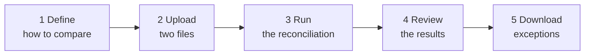

# 1. Business overview

**In one sentence:** reconArk takes two lists of transactions that should agree, for example a bank statement and
the company's general ledger, finds which entries match, which differ and which are missing, and explains every
difference.

## 1.1 The problem

Money moves through many systems: banks, card schemes, payment gateways, the company's own ledger. Each one keeps its
own record of the same transactions. They should agree, but often they don't:

- a payment is booked for a different amount (fees, rounding, currency conversion);
- it is booked on a different day (cut-off times, weekends);
- it is missing on one side (not yet settled, lost, duplicated);
- the files come in different formats (CSV from the bank, a fixed-width export from the ledger).

Finding these differences by hand in spreadsheets is slow, error-prone and impossible at volume. **Reconciliation**
is the job of comparing the two sides automatically and producing a list of exceptions for people to investigate.

## 1.2 What reconArk does

| Step | The user… | reconArk… |
|---|---|---|
| 1. Define | describes the two sources and the rules once (a **recon definition**) | checks the definition and saves it |
| 2. Upload | uploads the bank file as the **left** side and the ledger file as the **right** side | stores the files safely and fingerprints them |
| 3. Run | picks a definition and two files and presses *Start run* | reads both files, pairs the transactions and compares them, in parallel on several workers |
| 4. Review | opens the report | shows the match rate and every exception with its differences |
| 5. Download | downloads all results or just the exceptions as CSV | streams the file, even with millions of rows |

## 1.3 Key terms (glossary)

| Term | Meaning | Example |
|---|---|---|
| **Source** / **side** | One of the two lists being compared. reconArk calls them **left** and **right**. | Left = bank statement, right = general ledger |
| **Recon definition** | The saved instructions for one kind of reconciliation: how to read each side, how to pair records, how to compare them. | "Bank statement vs General ledger" |
| **Field** | A named value in a transaction. | `reference`, `amount`, `valueDate`, `currency` |
| **Field mapping** | Renames a file's column to the business field name, so both sides use the same names. | bank column `AMT` → field `amount` |
| **Match key** | The field(s) that identify the same transaction on both sides. | `reference` = `TXN-0006` |
| **Compare rule** | How one field is compared once two records are paired. | `amount`: numbers, allow 0.01 difference |
| **Tolerance** | How much difference is still accepted as equal. | amounts within 0.01; dates within 1 day |
| **Run** | One execution of a definition on two uploaded files. | "Bank vs GL, 12 Oct 10:30" |
| **Result** | The outcome for one match key. One of the four statuses below. | `TXN-0006 MISMATCHED (amount: 3000.00 vs 3100.00)` |
| **Rejected row** | A row that cannot take part because a match field is empty. Counted, not matched. | a bank row without a reference |
| **Match rate** | Matched results ÷ all results, in %. | 50 % |
| **Plugin** | A replaceable building block ("Lego brick"), e.g. a file format or a comparison rule. Adding one needs a developer once; using it is configuration. | `csv`, `fixed-width`, `number`, `date` |

### The four result statuses

| Status | Meaning | Typical action |
|---|---|---|
| **MATCHED** | Found on both sides; every compared field is equal (within tolerance). | None |
| **MISMATCHED** | Found on both sides, but at least one field differs. The result lists each difference. | Investigate: fee, wrong amount, late booking… |
| **ONLY IN LEFT** | Found only on the left side (e.g. in the bank, not in the ledger). | Book it in the ledger, or chase it |
| **ONLY IN RIGHT** | Found only on the right side (e.g. in the ledger, not in the bank). | Check whether the payment really happened |

## 1.4 A worked example

The repository ships with a small example (`code/deploy/sample-data`): a bank statement in CSV and a ledger export in
fixed-width format. The definition says:

- **match on** `reference`;
- **compare** `amount` as numbers with a tolerance of 0.01;
- **compare** `valueDate` as dates (bank format `2026-10-01`, ledger format `20261001`), allowing 1 day;
- **compare** `currency` exactly.

| Reference | Bank (left) | Ledger (right) | Result |
|---|---|---|---|
| TXN-0001 | 1500.00 AED, 1 Oct | 1500.00 AED, 1 Oct | MATCHED |
| TXN-0002 | 250.50 AED, 1 Oct | 250.50 AED, **2 Oct** | MATCHED (1 day is within tolerance) |
| TXN-0006 | **3000.00** AED | **3100.00** AED | MISMATCHED: amount |
| TXN-0007 | 4 Oct | **8 Oct** | MISMATCHED: valueDate |
| TXN-0008 | 60.00 **EUR** | 60.00 **AED** | MISMATCHED: currency |
| TXN-0009 | 820.00 AED | — | ONLY IN LEFT |
| TXN-0010 | — | 330.00 AED | ONLY IN RIGHT |
| (no reference) | 10.00 AED | — | rejected row |

Result: 5 matched, 3 mismatched, 1 only in left, 1 only in right, 1 rejected. Match rate 50 %.

## 1.5 What the screens look like

| Screen | Purpose |
|---|---|
| **Definitions** | List, create and edit recon definitions. The editor offers only the file formats and comparison rules that are installed. |
| **Files** | Upload a file for a definition and side; see recent uploads with size and fingerprint. |
| **Runs** | Start a run (definition + left file + right file); follow its progress live; see each job if something fails. |
| **Reports** | Match rate and counts; results filtered by status, 50 per page, with the differences highlighted; CSV downloads. |
| **Monitoring** | Links to the Grafana dashboard, Prometheus and Kafka UI for operations. |

Each screen is a separate **UI module**: an organisation that does not need one can switch it off in a configuration
file, without a new release.

## 1.6 Why "composable" (Lego) matters to the business

| Need | How reconArk handles it | Effort |
|---|---|---|
| A new partner sends a new layout of a known format | New definition (or field mapping) in the UI | Configuration only, minutes |
| A partner sends a new file format (e.g. XML, Excel) | A developer adds a *format plugin*; it then appears in the UI for every definition | Small development, once |
| A new comparison rule (e.g. "amount within 0.5 %") | A *comparator plugin* | Small development, once |
| A new report format (e.g. Excel, PDF) | A *report plugin* | Small development, once |
| More volume | Start more workers; no code change | Operations, minutes |
| A capability is not wanted | Switch the plugin or screen off in configuration | Configuration only |

## 1.7 Goals and limits of this version

| Goal | Target | Status in this version |
|---|---|---|
| Volume per run | Up to 100 million rows per side | Designed for it (parallel workers, buckets); to be proven with the performance test in the testing guide |
| Run time | Under 40 minutes for 100 million rows | Depends on hardware and worker count; measure with `generate.py` |
| Formats | Any, through plugins | CSV and fixed-width included |
| Availability | Survives a worker or manager crash without losing a run | Jobs are retried automatically |
| Security | Bank-grade (login, roles, audit, encryption) | **Not yet**: see [Roadmap](07-roadmap.md) R1–R4. Do not use with real customer data before these are done. |

**Not in this version** (see the [Roadmap](07-roadmap.md)): user login and roles, maker-checker approval of
definitions, exception workflow (assigning and closing exceptions), scheduled runs, one-to-many matching (one payment
settling several invoices), and cloud object storage.
