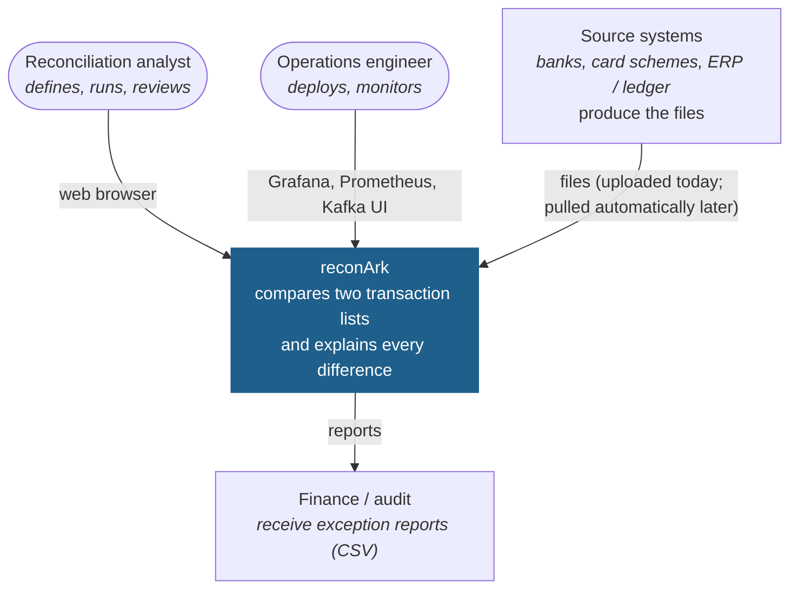
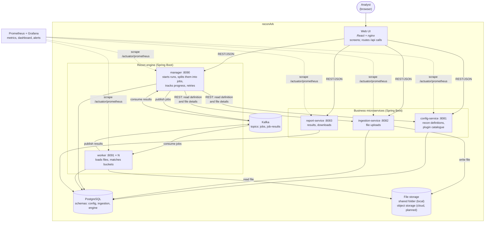
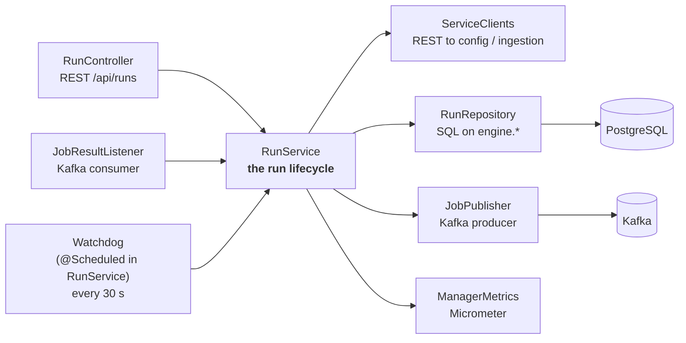
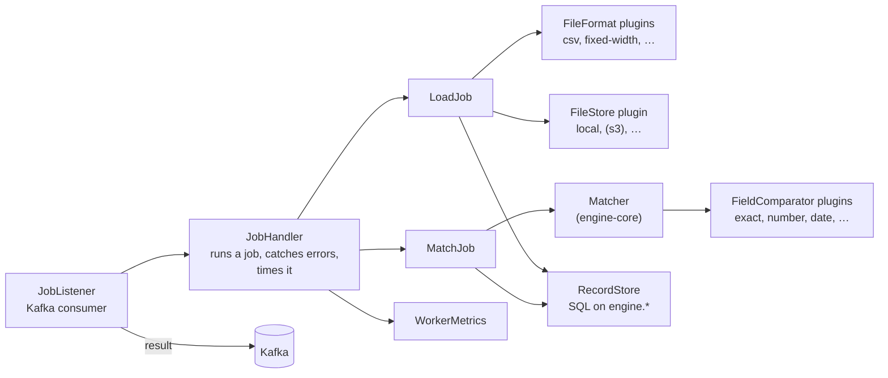
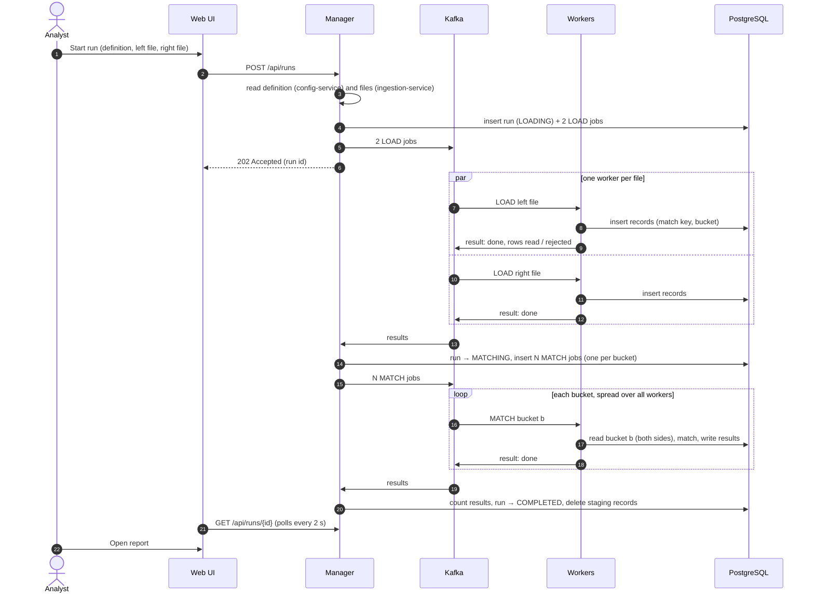
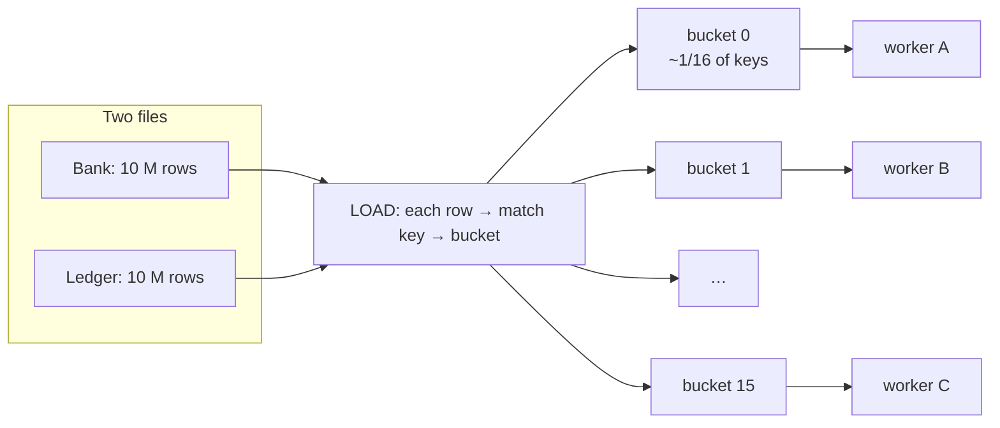
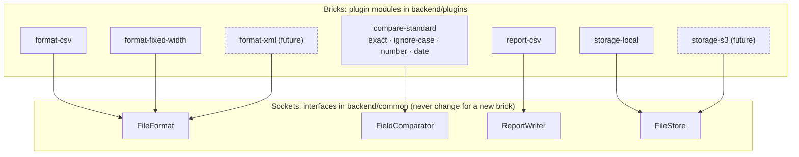
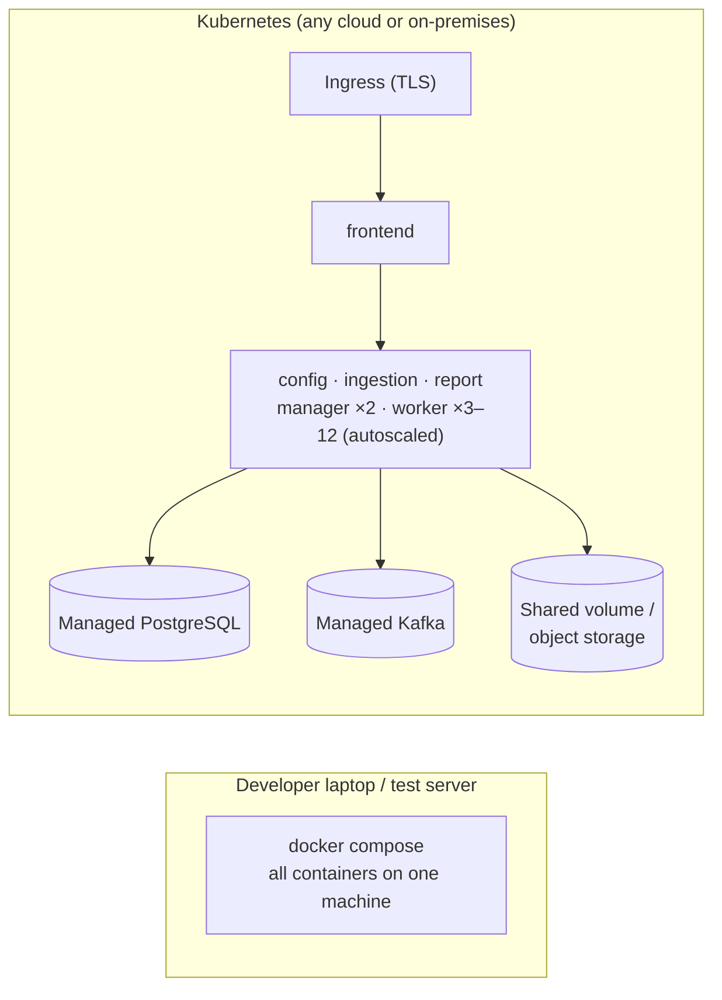

# 2. Architecture: C4 model and high-level design (HLD)

**Summary.** reconArk is a set of small Spring Boot services and a React UI. The heavy work, reading big files and
matching millions of records, is done by a **distributed recon engine**: one **manager** splits each run into jobs
and puts them on **Kafka**; any number of **workers** take jobs, do them and report back. Everything is stored in
**PostgreSQL**. **Prometheus** and **Grafana** watch every service. File formats, comparison rules, report formats and
storage are **plugins** that are switched on or off by configuration.

The [C4 model](https://c4model.com) describes software at four zoom levels: context, containers, components and code.
Sections 2.1–2.3 are the first three levels; the code level is the [LLD](03-detailed-design.md).

## 2.1 Level 1: System context

*Who uses reconArk, and which other systems does it touch?*

## 2.2 Level 2: Containers

*What are the separately running pieces, and how do they talk?* (A "container" in C4 is anything that runs on its
own: an app, a database, a broker. It is not necessarily a Docker container, although here each one is.)

| Container | Responsibility | Owns (database schema) | Talks to |
|---|---|---|---|
| **Web UI** | All screens. Composed of switchable UI modules. nginx serves it and routes each `/api/...` path to the owning service. | — | All services over REST |
| **config-service** | Create, edit, validate recon definitions. Lists the installed plugins (formats, comparators) for the editor. | `config` | PostgreSQL |
| **ingestion-service** | Receives uploads, stores the file through the storage plugin, records name, size, SHA-256 fingerprint. | `ingestion` | PostgreSQL, file storage |
| **manager** | The orchestrator. Starts runs, creates jobs, sends them to Kafka, receives results, retries failed or lost jobs, completes the run. | `engine` (creates the tables) | config-service, ingestion-service, Kafka, PostgreSQL |
| **worker** | The muscle. LOAD jobs read a file and store its records; MATCH jobs match one bucket and store the results. Scales horizontally. | writes `engine.recon_record`, `engine.recon_result` | Kafka, PostgreSQL, file storage |
| **report-service** | Read-only: run summaries, paged results, streamed CSV downloads through report plugins. | reads `engine` | PostgreSQL |
| **Kafka** | Delivers jobs to workers (each job to exactly one worker) and results back to the manager. | — | — |
| **PostgreSQL** | The single source of truth: definitions, uploads, runs, jobs, records, results. | — | — |
| **Prometheus / Grafana** | Collect metrics from every service, draw the dashboard, evaluate alert rules. | — | All services |

## 2.3 Level 3: Components

*What is inside the two most important containers?*

### Manager

### Worker

The three business services follow the same simple pattern: **Controller** (REST) → **Service** (rules) →
**Repository** (SQL with Spring `JdbcClient`). No hidden framework magic.

## 2.4 How a run works

### The happy path

### Why buckets? (how the work is split)

Matching needs the left and right records with the same match key **together**. Each record's bucket is computed from
its match key (`hash(matchKey) mod bucketCount`), so the same key always lands in the same bucket, on both sides.
Every bucket can then be matched **independently**, by any worker, in parallel.

More buckets = smaller pieces = more parallelism and less memory per job. Default 16; for 100 M rows use 256 or more
(see the [Operations guide](06-operations-guide.md#63-sizing-and-scaling)).

### When things go wrong

| What fails | What happens | Data loss? |
|---|---|---|
| A job fails (bad file, database hiccup) | Worker reports failure → manager sends the job again (up to 3 attempts) → then the run is FAILED with the reason | No |
| A worker crashes mid-job | Kafka gives the job to another worker (the message was not acknowledged). The watchdog also re-sends any job without an answer after 10 minutes. | No |
| The manager crashes | Jobs and run state are in PostgreSQL. A restarted (or second) manager carries on; Kafka keeps the unread results. | No |
| A job runs twice (retry, duplicate message) | Jobs are **idempotent**: LOAD first deletes what an earlier attempt stored; MATCH replaces the bucket's results. The manager ignores duplicate or late answers. | No |
| Kafka is down | Starting a run still records it; the watchdog sends the jobs when Kafka is back. | No |
| PostgreSQL is down | Everything stops (it is the source of truth). Use a managed, highly available PostgreSQL in production. | No (if backed up) |

The rule that makes this simple: **change the database in a transaction first, send Kafka messages after the commit.**
If the process dies in between, the job is `QUEUED` in the database and the watchdog sends it later.

## 2.5 Composability: the three kinds of Lego bricks

| Brick | Where | Plug in | Switch off |
|---|---|---|---|
| **Plugin** (format, comparator, report, storage) | `code/backend/plugins/<name>` | add the module as a dependency of the services that use it | `reconark.plugins.<name>.enabled=false` |
| **Microservice** | `code/backend/services/<name>` | add a Helm release / compose service; add its `/api` route to nginx | don't deploy it; hide its UI module |
| **UI module** | `code/frontend/src/modules/<name>` | add it to `src/shell/modules.ts` | remove its id from `public/config.json` (no rebuild) |

Engines and services only ever use the interfaces (`FileFormat`, `FieldComparator`, …) and look plugins up by id from
a `PluginRegistry`, so adding a brick never changes them. Technically, every plugin is a Spring Boot
*auto-configuration*: a class that registers a bean when the module is on the classpath and its `enabled` property is
not `false`. This is the same mechanism Spring Boot itself uses, so there is nothing new to learn.

## 2.6 Data

One PostgreSQL database, one **schema per service** (`config`, `ingestion`, `engine`). Each service creates its own
tables with Flyway at start-up. Services never write another service's schema; report-service only reads `engine`.
Full table definitions are in the [LLD](03-detailed-design.md#33-data-model).

| Data | Volume | Kept |
|---|---|---|
| Definitions, uploads, runs, jobs | small | until deleted |
| Staging records (`engine.recon_record`) | = rows in both files | only while the run is busy (deleted at completion) |
| Results (`engine.recon_result`) | = number of match keys | until a retention job deletes them (roadmap) |

## 2.7 Security

| Area | This version | Required before production ([Roadmap](07-roadmap.md)) |
|---|---|---|
| Login | none (local use) | Single sign-on with OpenID Connect (Keycloak, Entra ID, Okta) at the gateway or in each service |
| Authorisation | none | Roles: viewer, analyst, admin; maker-checker for definitions |
| Transport | HTTP inside the compose network | TLS everywhere (ingress, Kafka, PostgreSQL) |
| Secrets | local passwords in docker-compose | Kubernetes Secrets / cloud secret manager (the Helm chart already reads the DB password from a Secret) |
| Files | path-traversal protection in storage-local, SHA-256 fingerprint | Virus scan on upload, encryption at rest |
| Reports | CSV injection protection (`=`, `+`, `@` prefixed) | Masking of sensitive fields (card numbers, IBANs) |
| Containers | non-root, read-only file system, dropped capabilities (Helm) | Image scanning, signed images |

## 2.8 Monitoring

Every service exposes metrics at `/actuator/prometheus` (Spring Boot Actuator + Micrometer). Prometheus scrapes them
every 15 seconds; Grafana shows the **reconArk** dashboard; Prometheus evaluates four alert rules.

| What you see | Metric |
|---|---|
| Runs started / completed / failed, runs in progress | `reconark_runs_started_total`, `reconark_runs_finished_total{outcome}`, `reconark_runs_active` |
| Jobs waiting for a worker | `reconark_jobs_queued` |
| Records loaded per second, results per status | `reconark_worker_records_loaded_total`, `reconark_worker_results_total{status}` |
| Job duration and failures | `reconark_worker_jobs_seconds{type,outcome}` |
| Kafka consumer lag (workers keeping up?) | `kafka_consumer_fetch_manager_records_lag_max` |
| HTTP rate and errors, JVM memory, DB connections, CPU | standard Spring Boot metrics |

Details and the alert runbook: [Operations guide](06-operations-guide.md#64-monitoring-and-alerts).

## 2.9 Deployment

| Where | How | Notes |
|---|---|---|
| Laptop / test | `code/deploy/start.sh` (docker compose) | Includes Kafka, PostgreSQL, Prometheus, Grafana, Kafka UI |
| Kubernetes | One Helm chart (`code/deploy/helm/reconark-service`), one release per service with its values file | Workers autoscale on CPU |
| AWS | EKS + RDS for PostgreSQL + Amazon MSK + EFS (or S3 with a storage plugin) | |
| Azure | AKS + Azure Database for PostgreSQL + Event Hubs (Kafka API) + Azure Files (or Blob) | |
| GCP | GKE + Cloud SQL + Managed Service for Apache Kafka + Filestore (or GCS) | |

## 2.10 Technology stack: why, learning curve, alternatives

Learning curve is for a developer with 2–3 years of experience: **Low** = productive in days, **Medium** = a couple of
weeks, **High** = months.

| Layer | Choice | Why it fits | Learning curve | Alternatives (and when to pick them) |
|---|---|---|---|---|
| Language | **Java 25** (LTS) | Long-term support; records, pattern matching and virtual threads make code short and fast; the most common enterprise skill | Low | Kotlin (more concise, same JVM); Java 21 if your platform has no 25 yet |
| Framework | **Spring Boot 4** | De-facto standard for Java services; Actuator, Kafka, JDBC, Flyway, metrics all built in | Low–Medium | Quarkus or Micronaut (faster start-up, smaller memory; smaller community) |
| Data access | **Spring JdbcClient + plain SQL** | What you read is what runs; no ORM surprises; fast bulk inserts | Low | Spring Data JPA (less SQL, but hides queries; poor for bulk); jOOQ (type-safe SQL, extra build step) |
| Database | **PostgreSQL 18** | Reliable, free, excellent JSON (`jsonb`) and SQL; managed on every cloud | Low | Oracle / SQL Server if mandated (SQL needs small changes); not MongoDB (we need transactions and joins) |
| Migrations | **Flyway** | Plain SQL files, versioned, run at start-up | Low | Liquibase (XML/YAML, more features) |
| Messaging | **Apache Kafka** | Durable, ordered, partitioned: exactly what a job queue for many workers needs; consumer groups share the work automatically; managed on every cloud | Medium | **RabbitMQ** (simpler queue semantics, lower learning curve: good choice if you don't already run Kafka); a PostgreSQL job table with `SKIP LOCKED` (no broker at all; fine up to moderate scale) |
| Frontend | **React 19 + TypeScript + Vite** | Largest ecosystem; TypeScript catches errors early; Vite is fast | Medium | Angular (more structure, steeper); Vue (gentler curve) |
| Data fetching | **TanStack Query** | Caching, polling and error states in one hook | Low | SWR; plain `fetch` with `useEffect` |
| Metrics | **Micrometer → Prometheus** | Built into Spring Boot; Prometheus is the cloud-native standard | Low | OpenTelemetry metrics (vendor-neutral, more setup) |
| Dashboards / alerts | **Grafana** | Free, rich dashboards, works with Prometheus out of the box | Low | Datadog, New Relic, Dynatrace, cloud consoles (paid, less setup) |
| Build | **Gradle (Kotlin DSL)** | Fast incremental builds; one build for all modules | Medium | **Maven** (more familiar to many Java developers, more verbose, slower; a fine alternative) |
| Tests | **JUnit 5, AssertJ, Testcontainers, Vitest** | Testcontainers runs a real PostgreSQL in tests, so SQL is tested for real | Low–Medium | H2 in-memory DB (faster, but not real PostgreSQL) |
| Containers | **Docker + docker compose** | One command to run everything locally | Low | Podman |
| Orchestration | **Kubernetes + Helm** | Runs on every cloud and on-premises; autoscaling | Medium–High | Cloud container services without Kubernetes: AWS ECS, Azure Container Apps, Google Cloud Run (simpler, less portable) |

### What was deliberately left out (to stay simple)

| Not used | Why not (yet) |
|---|---|
| A custom plugin kernel, plugin versioning, trust tiers | Spring Boot auto-configuration gives on/off plugins with zero extra concepts |
| Spring Batch | Our job model (LOAD + MATCH per bucket) is small and explicit; Spring Batch adds many concepts |
| An API gateway / BFF service | nginx routes `/api` paths; add a gateway when login (OIDC) is added |
| Microfrontends (Module Federation) | One React build with switchable modules is enough until teams need to release screens independently |
| Redis / caches | Nothing is slow enough to need one |
| Transactional outbox table | "DB first, Kafka after commit, watchdog re-sends" gives the same safety for jobs with less code |
