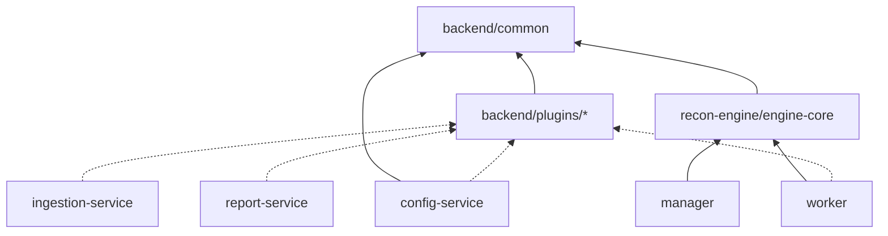
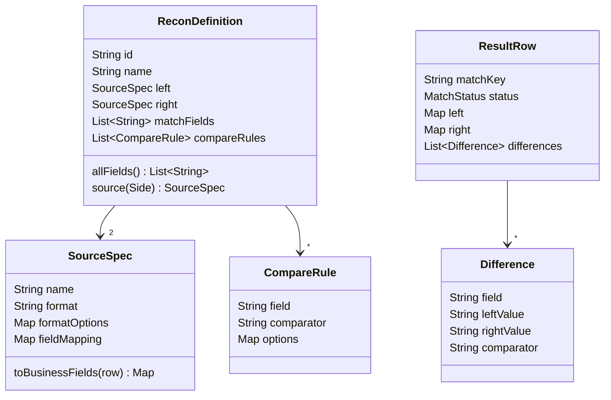
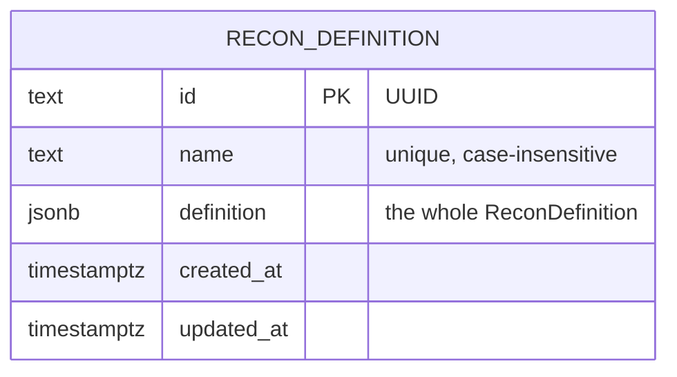
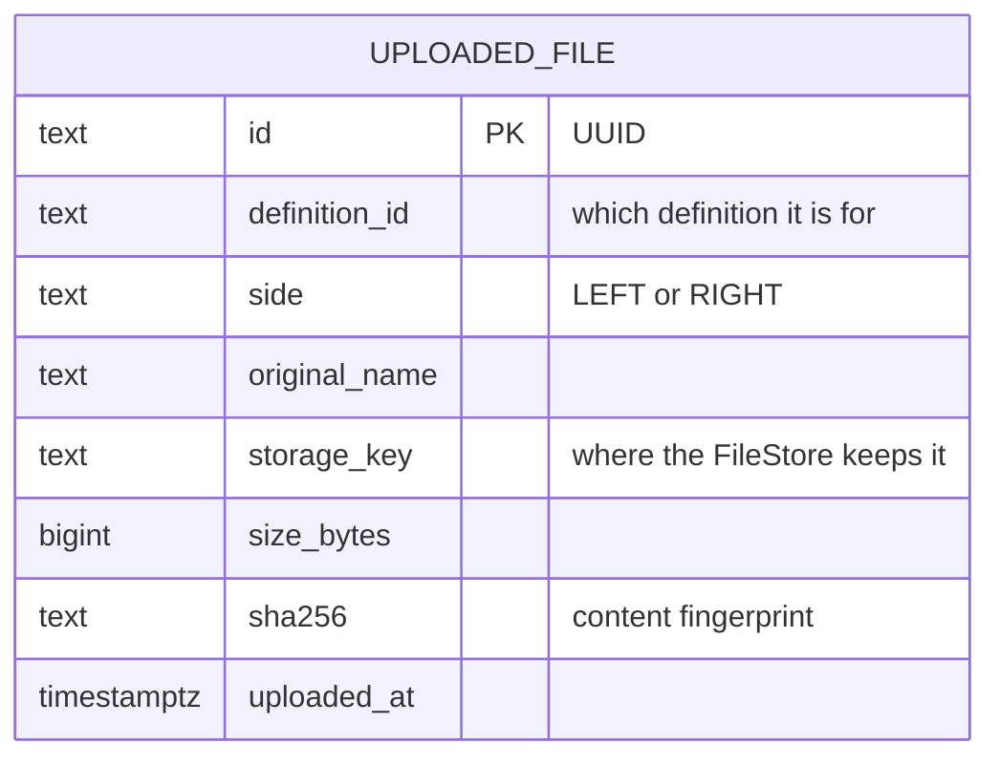
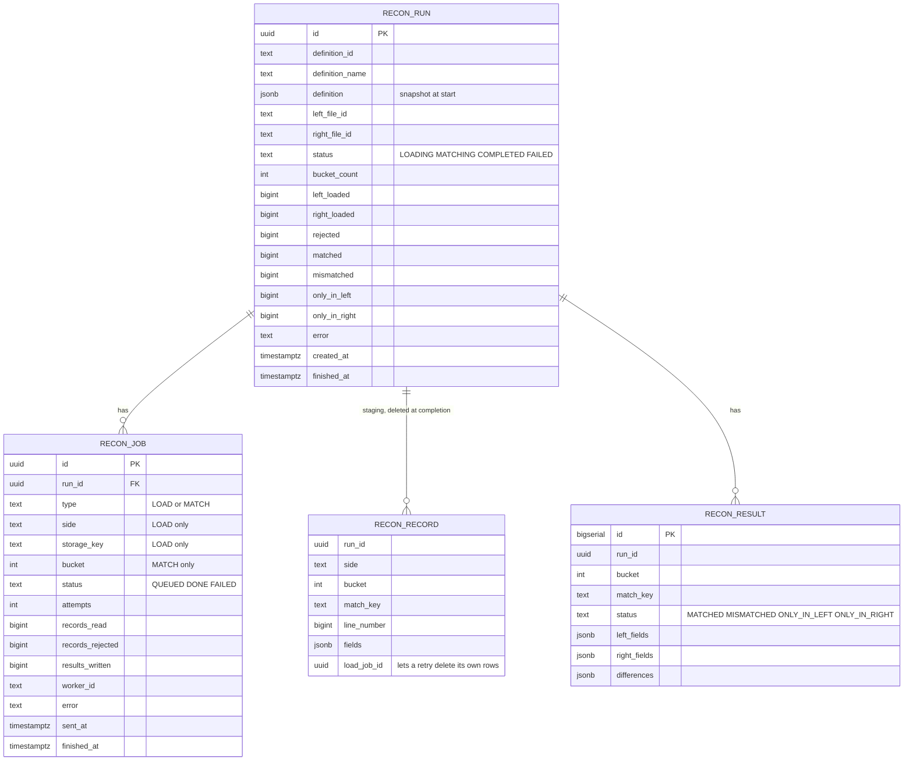
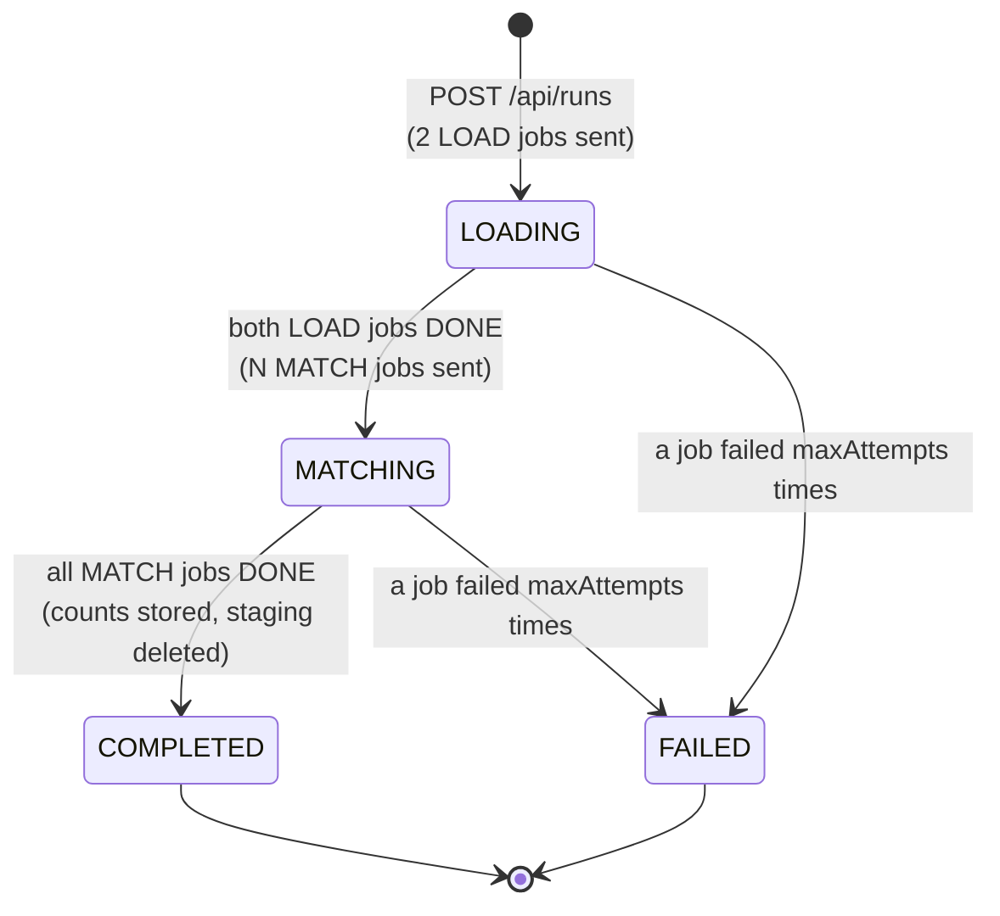
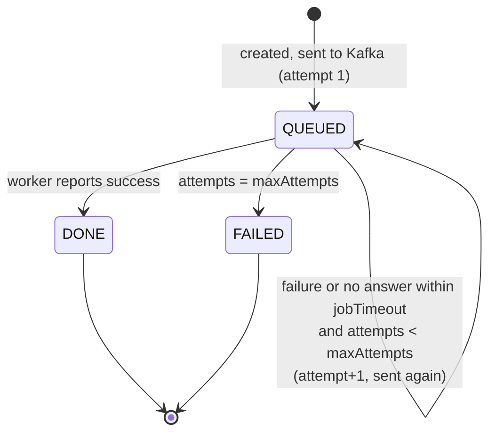
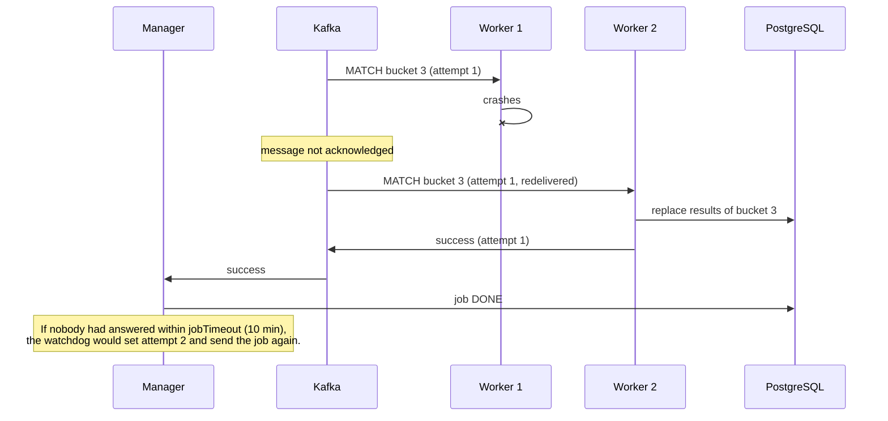

# 3. Detailed design (LLD)

**Summary.** This document goes down to code level: modules and packages, the plugin interfaces, every table, every
REST endpoint, the Kafka messages, the state machines, the matching algorithm and all settings. Read the
[Architecture](02-architecture.md) first.

## 3.1 Code layout and module dependencies

```
code/
├── settings.gradle.kts          lists every Java module
├── build.gradle.kts             settings shared by all modules (Java 25, Spring Boot BOM, JUnit)
├── backend/
│   ├── common/                  model (records) + plugin interfaces; plain Java, no Spring
│   ├── plugins/
│   │   ├── format-csv/          FileFormat "csv"
│   │   ├── format-fixed-width/  FileFormat "fixed-width"
│   │   ├── compare-standard/    FieldComparator "exact", "ignore-case", "number", "date"
│   │   ├── report-csv/          ReportWriter "csv"
│   │   └── storage-local/       FileStore "local"
│   └── services/
│       ├── config-service/      :8081  definitions + plugin catalogue
│       ├── ingestion-service/   :8082  uploads
│       └── report-service/      :8083  results + downloads
├── recon-engine/
│   ├── engine-core/             Kafka messages, matching algorithm, engine tables (SQL); plain Java
│   ├── manager/                 :8090  run lifecycle
│   └── worker/                  :8091  LOAD and MATCH jobs
├── frontend/                    React app (npm)
└── deploy/                      docker compose, Helm, Prometheus, Grafana, sample data
```



Solid arrows: compile against. Dotted: carries plugins (any plugin can be removed from a service's
`build.gradle.kts` without code changes elsewhere). **Rules:** `common` and `engine-core` never depend on Spring;
plugins never depend on each other or on a service; services never depend on each other's code (they talk REST or
Kafka).

Java packages: `io.reconark.common`, `io.reconark.plugins.<plugin>`, `io.reconark.<service>` (`config`, `ingestion`,
`report`, `manager`, `worker`), `io.reconark.engine`.

## 3.2 The model and the plugin interfaces

### Model (`io.reconark.common.model`)



All model classes are Java **records** (immutable data). A record's values are always strings as read from the file;
comparators decide how to interpret them (number, date, text).

### Plugin interfaces (`io.reconark.common.plugin`)

| Interface | Method(s) | Built-in plugins |
|---|---|---|
| `Plugin` | `id()`, `description()` | (base of all) |
| `FileFormat` | `read(InputStream, options, Consumer<row>)`: must stream | `csv`, `fixed-width` |
| `FieldComparator` | `same(left, right, options) → boolean` | `exact`, `ignore-case`, `number`, `date` |
| `ReportWriter` | `contentType()`, `fileExtension()`, `write(fields, Iterator<ResultRow>, OutputStream)` | `csv` |
| `FileStore` | `save(name, InputStream) → key`, `open(key) → InputStream` | `local` |
| `PluginRegistry<T>` | `get(id)`, `contains(id)`, `all()` | built by each service from the active plugins |

### Plugin options

| Plugin | Option | Default | Meaning |
|---|---|---|---|
| `csv` | `delimiter` | `,` | One character, or `tab` |
| | `header` | `true` | First line holds column names |
| | `columns` | — | Column names when `header=false` (`ref,amount`) |
| | `encoding` | `UTF-8` | |
| `fixed-width` | `columns` | required | `name:start:length,...`, start is 1-based (`reference:1:12,amount:21:12`) |
| | `skipLines` | `0` | Header lines to skip |
| | `encoding` | `UTF-8` | |
| `exact` | — | | Equal after trimming spaces; empty = missing |
| `ignore-case` | — | | Like exact, ignoring upper/lower case |
| `number` | `tolerance` | `0` | Absolute difference allowed (`0.01`). "10.0" = "10.00" |
| `date` | `format` | `yyyy-MM-dd` | Pattern for both sides ([Java patterns](https://docs.oracle.com/en/java/javase/25/docs/api/java.base/java/time/format/DateTimeFormatter.html)) |
| | `leftFormat` / `rightFormat` | `format` | Pattern for one side |
| | `toleranceDays` | `0` | Days of difference allowed |
| `local` (storage) | `reconark.plugins.storage-local.root` | `<temp>/reconark/files` | Folder shared by ingestion-service and workers (`STORAGE_ROOT`) |

## 3.3 Data model

### `config` schema (config-service)



### `ingestion` schema (ingestion-service)



### `engine` schema (manager creates; workers write; report-service reads)



Indexes: `recon_record (run_id, bucket)` for MATCH jobs; `recon_result (run_id, status, id)` for paged and filtered
reports; `recon_job (run_id, type, status)` for progress checks; a partial index on queued jobs for the watchdog.
The SQL is in `code/*/src/main/resources/db/migration/`.

## 3.4 REST APIs

All APIs speak JSON. Errors are [Problem Details](https://www.rfc-editor.org/rfc/rfc9457) (`{"status":400,"detail":"…"}`).

| Service | Method and path | Request | Response |
|---|---|---|---|
| config | `GET /api/definitions` | — | `ReconDefinition[]` sorted by name |
| config | `GET /api/definitions/{id}` | — | `ReconDefinition` or 404 |
| config | `POST /api/definitions` | `ReconDefinition` (id ignored) | 201 + saved definition; 400 lists every problem |
| config | `PUT /api/definitions/{id}` | `ReconDefinition` | 200, 400 or 404 |
| config | `DELETE /api/definitions/{id}` | — | 204 or 404 |
| config | `POST /api/definitions/validate` | `ReconDefinition` | `{"valid":bool,"problems":[…]}` |
| config | `GET /api/plugins` | — | `[{kind, id, description}]` (kind = format or comparator) |
| ingestion | `POST /api/files` | multipart: `file`, `definitionId`, `side` | 201 + `UploadedFile` |
| ingestion | `GET /api/files?definitionId=&side=` | filters optional | latest 200 `UploadedFile` |
| ingestion | `GET /api/files/{id}` | — | `UploadedFile` or 404 |
| manager | `POST /api/runs` | `{definitionId, leftFileId, rightFileId}` | 202 + `Run`; 400 if a file belongs to another definition or side |
| manager | `GET /api/runs` | — | latest 100 `Run` |
| manager | `GET /api/runs/{id}` | — | `Run` (status, counts, error) |
| manager | `GET /api/runs/{id}/jobs` | — | `Job[]` (for troubleshooting) |
| report | `GET /api/reports/runs/{id}/summary` | — | `RunSummary` incl. `matchRatePercent`, `fields` |
| report | `GET /api/reports/runs/{id}/results?status=&page=0&size=50` | size 1–500 | `{page,size,total,items: ResultRow[]}` |
| report | `GET /api/reports/runs/{id}/export?format=csv&status=` | — | file download (streamed); 409 if the run is not COMPLETED |
| report | `GET /api/reports/formats` | — | report plugins |
| all | `GET /actuator/health`, `/actuator/prometheus` | — | health, metrics |

Example definition (the sample in `code/deploy/sample-data/definition.json`):

```json
{
  "name": "Bank statement vs General ledger",
  "left":  { "name": "Bank statement", "format": "csv", "formatOptions": {"delimiter": ","},
             "fieldMapping": {"reference": "REF", "valueDate": "VALUE_DATE", "amount": "AMT", "currency": "CCY"} },
  "right": { "name": "General ledger", "format": "fixed-width",
             "formatOptions": {"columns": "reference:1:12,valueDate:13:8,amount:21:12,currency:33:3", "skipLines": "1"} },
  "matchFields": ["reference"],
  "compareRules": [
    {"field": "amount", "comparator": "number", "options": {"tolerance": "0.01"}},
    {"field": "valueDate", "comparator": "date", "options": {"leftFormat": "yyyy-MM-dd", "rightFormat": "yyyyMMdd", "toleranceDays": "1"}},
    {"field": "currency", "comparator": "exact"}
  ]
}
```

## 3.5 Kafka topics and messages

| Topic | Producer → consumer | Key | Consumer group |
|---|---|---|---|
| `reconark.engine.jobs.v1` | manager → workers | run id | `recon-workers` (all workers share it: each job goes to one worker) |
| `reconark.engine.job-results.v1` | workers → manager | run id | `recon-manager` |

Both topics have 12 partitions by default (`reconark.manager.kafka.partitions`). **At most one worker per partition
works at a time**, so partitions ≥ total worker threads. Messages are JSON strings.

`JobMessage` (LOAD):

```json
{ "jobId": "3f…", "runId": "9a…", "type": "LOAD", "attempt": 1, "bucketCount": 16,
  "definition": { …ReconDefinition… }, "side": "LEFT", "storageKey": "2026/10/12/…-bank.csv", "bucket": null }
```

`JobMessage` (MATCH): same, with `"type": "MATCH", "bucket": 7, "side": null, "storageKey": null`.

`JobResultMessage`:

```json
{ "jobId": "3f…", "runId": "9a…", "type": "LOAD", "attempt": 1, "success": true,
  "recordsRead": 10, "recordsRejected": 1, "resultsWritten": 0,
  "workerId": "worker-2", "durationMillis": 412, "error": null }
```

Workers read with `max.poll.records=1` (one job at a time per thread) and `max.poll.interval.ms=1h` (a large file
may take long). The message is acknowledged only after the result is sent.

## 3.6 State machines

### Run



### Job



A result is applied only if the job is still `QUEUED` **and** its `attempt` equals the job's current attempt;
anything else is a duplicate or a late answer and is ignored. The run row is locked (`SELECT … FOR UPDATE`) while a
result is applied, so two results of one run never race.

### Retry and watchdog



## 3.7 The matching algorithm

**LOAD** (one job per file), in `LoadJob`:

1. Delete records an earlier attempt of this job stored (`load_job_id`).
2. Read the file with the definition's `FileFormat` plugin, row by row (streaming).
3. Rename columns to business fields (`SourceSpec.fieldMapping`).
4. Build the **match key**: the trimmed values of `matchFields` joined with `|` (`TXN-0006`, or `TXN-0006|AED` for
   two fields). If any match field is blank, the row is **rejected** (counted only).
5. **Bucket** = `floorMod(matchKey.hashCode(), bucketCount)`. Java's `String.hashCode` is the same on every machine.
6. Insert records in batches of 1 000 (PostgreSQL driver with `reWriteBatchedInserts=true`).

**MATCH** (one job per bucket), in `MatchJob` and `Matcher`:

1. Read all records of the bucket, both sides.
2. Group by match key per side, keeping file order.
3. For each key, pair the 1st left with the 1st right, the 2nd with the 2nd, …
   - for each pair, apply every compare rule; no differences → `MATCHED`, otherwise `MISMATCHED` with the list of
     differences;
   - unpaired left records → `ONLY_IN_LEFT`; unpaired right → `ONLY_IN_RIGHT`.
4. In one transaction: delete this bucket's old results, insert the new ones.

Example with duplicates: left has `T1` three times, right twice → 2 pairs compared, 1 `ONLY_IN_LEFT`.

Memory: a MATCH job holds one bucket in memory. With `R` rows per side and `B` buckets, that is about `2R/B` records;
keep it under ~1 million (e.g. 100 M rows → B ≥ 256).

## 3.8 Configuration reference

Every property can be set as an environment variable: upper-case it, replace dots with `_` and drop dashes
(`reconark.manager.bucket-count` → `RECONARK_MANAGER_BUCKETCOUNT`).

| Property / env var | Service | Default | Meaning |
|---|---|---|---|
| `DB_URL`, `DB_USER`, `DB_PASSWORD` | all | localhost, `reconark` | PostgreSQL connection |
| `KAFKA_BOOTSTRAP_SERVERS` | manager, worker | `localhost:9092` | Kafka |
| `STORAGE_ROOT` | ingestion, worker | `<temp>/reconark/files` | Shared upload folder (storage-local plugin) |
| `PORT` | all | 8081/8082/8083/8090/8091 | HTTP port |
| `reconark.manager.bucket-count` | manager | 16 | MATCH jobs per run |
| `reconark.manager.max-attempts` | manager | 3 | Tries per job before the run fails |
| `reconark.manager.job-timeout` | manager | `10m` | No answer after this → re-send |
| `reconark.manager.keep-staging-records` | manager | false | Keep loaded records after completion (debugging) |
| `reconark.manager.kafka.partitions` / `.replicas` | manager | 12 / 1 | Topic creation settings (replicas 3 in production) |
| `CONFIG_SERVICE_URL`, `INGESTION_SERVICE_URL` | manager | localhost:8081 / 8082 | Where to read definitions and files |
| `reconark.worker.concurrency` | worker | 2 | Jobs one worker runs at the same time |
| `reconark.plugins.<plugin>.enabled` | any service carrying the plugin | true | Switch a plugin off |
| `spring.servlet.multipart.max-file-size` | ingestion | 2GB | Upload limit |

## 3.9 Metrics reference

| Prometheus name | Type | Labels | Service |
|---|---|---|---|
| `reconark_runs_started_total` | counter | | manager |
| `reconark_runs_finished_total` | counter | `outcome` = completed, failed | manager |
| `reconark_jobs_retried_total` | counter | | manager |
| `reconark_run_duration_seconds` | timer | | manager |
| `reconark_jobs_queued` | gauge | | manager |
| `reconark_runs_active` | gauge | `status` = LOADING, MATCHING | manager |
| `reconark_worker_jobs_seconds` | timer | `type`, `outcome` | worker |
| `reconark_worker_records_loaded_total` | counter | `side` | worker |
| `reconark_worker_records_rejected_total` | counter | `side` | worker |
| `reconark_worker_results_total` | counter | `status` | worker |

Plus Spring Boot's standard metrics (`http_server_requests_seconds`, `jvm_*`, `hikaricp_*`, `kafka_consumer_*`), all
tagged with `application`.

## 3.10 Error handling

| Situation | Where | Result |
|---|---|---|
| Invalid definition | config-service | 400 with every problem joined by `;` |
| Unknown definition / file / run | all | 404 |
| File of the wrong side or definition | manager | 400 |
| Malformed file (wrong column count, unclosed quote) | worker LOAD | job fails with `csv: line 42 has 3 values…`; retried; run FAILED with that message |
| Unknown plugin id in a definition | worker | job fails: `Unknown format plugin 'xml'. Available: [csv, fixed-width]` |
| Report requested before the run completed | report-service | 409 |
| Kafka unavailable when a run starts | manager | run recorded; jobs sent by the watchdog later |

Error messages name lines and fields, never data values, so logs stay free of customer data.

## 3.11 Frontend design

```
frontend/src/
├── main.tsx, App.tsx          the shell: menu + routes of the enabled modules
├── shell/                     UiModule contract, module registry, config.json loader
├── shared/                    API helper, TypeScript types, small components, key=value helpers
└── modules/
    ├── definitions/           list + editor (DefinitionsPage, DefinitionEditorPage, definitionForm.ts)
    ├── files/                 upload + recent uploads
    ├── runs/                  start run, run list, run detail with jobs (live refresh)
    ├── reports/               summary, filtered paged results, downloads
    └── monitoring/            links to Grafana, Prometheus, Kafka UI
```

A module is `{ id, title, home, routes: [{ path, Page }] }`. `public/config.json` lists which modules are shown and
the monitoring links; nginx serves it with `no-cache`, so operations can change it without rebuilding.
