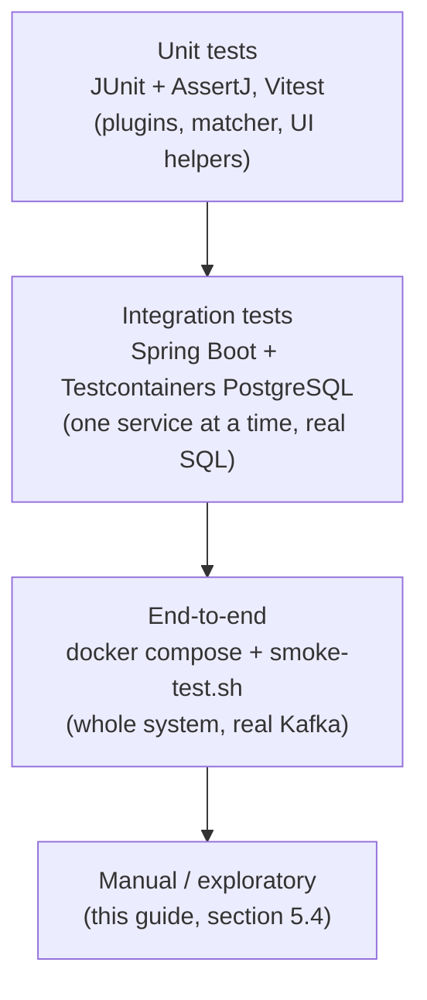

# 5. Testing guide

**Summary.** Three layers of automated tests run on every pull request: unit tests (plain Java and TypeScript),
integration tests against a real PostgreSQL in Docker, and an end-to-end smoke test of the whole system in docker
compose. This guide lists them, then gives manual test cases a tester can follow step by step, with the expected
result for each.

## 5.1 Test strategy



| Layer | What it proves | Where | Runs |
|---|---|---|---|
| Unit | Each plugin and the matching algorithm behave correctly, including edge cases | `*/src/test/java`, `frontend/src/**/*.test.ts` | every build, seconds |
| Integration | Each service works with a real database: SQL, transactions, idempotency, retries | `*ApiTest`, `*JobsTest`, `RunLifecycleTest`, `UploadTest` | every build (needs Docker), ~1 min |
| End-to-end | All containers together: upload → run over Kafka → report → download | `code/deploy/smoke-test.sh`, CI job `e2e` | every pull request, ~5 min |
| Manual | The user experience, odd files, resilience, performance | section 5.4–5.7 | before a release |

## 5.2 Automated tests and what they cover

| Test class | Covers |
|---|---|
| `PluginRegistryTest`, `SourceSpecTest` | Plugin lookup, clear error for unknown ids, duplicate ids; field mapping |
| `CsvFileFormatTest` | Header, quotes, escaped quotes, multi-line values, other delimiters, no header, blank lines, byte-order mark, malformed line number |
| `FixedWidthFileFormatTest` | Column cutting, skip lines, short lines, missing `columns` option |
| `StandardComparatorsTest` | exact (spaces, empty = missing), ignore-case, number (scale, tolerance, negatives, non-numbers), date (formats per side, tolerance) |
| `CsvReportWriterTest` | Report layout, CSV escaping, formula (CSV-injection) protection |
| `LocalFileStoreTest` | Save/open, path-traversal refusal, safe file names |
| `MatchKeysTest`, `MatcherTest` | Key building, rejected rows, bucket stability; all four statuses, differences, duplicates in file order |
| `DefinitionApiTest` (config-service) | Create/read/update/delete, every validation problem reported, unique names, plugin catalogue |
| `UploadTest` (ingestion-service) | File stored and readable, size and SHA-256, filters |
| `WorkerJobsTest` (worker) | Real LOAD + MATCH on two files with real plugins; retries don't duplicate records or results; unknown format fails clearly |
| `RunLifecycleTest` (manager) | LOADING → MATCHING → COMPLETED, counts, duplicate results ignored, retry then FAILED |
| `ReportApiTest` (report-service) | Summary and match rate, paging and filters, streamed CSV export, 404 |
| `modules.test.ts`, `keyValues.test.ts`, `definitionForm.test.ts` | UI module switching, option parsing, form ↔ definition conversion |

Run them:

```bash
cd code && ./gradlew build                 # all Java tests (Docker must be running)
cd code/frontend && npm test               # UI tests
cd code && deploy/start.sh && deploy/smoke-test.sh   # end to end
```

Test reports: `code/**/build/reports/tests/test/index.html`.

## 5.3 Test data

| Data | Where | Use |
|---|---|---|
| Small hand-checked sample | `code/deploy/sample-data/bank.csv`, `ledger.txt`, `definition.json` | Functional tests; every expected outcome is listed in its `README.md` |
| Large generated files | `python3 code/deploy/sample-data/generate.py 1000000` | Performance; the script prints the expected counts |
| Edge-case files | create them as described in the test cases below | Negative tests |

Expected outcome of the small sample: **matched 5, mismatched 3 (amount, date, currency), only in left 1, only in
right 1, rejected 1, match rate 50 %.**

## 5.4 Manual test cases: functional (UI)

Start the system with `code/deploy/start.sh`; open http://localhost:8080.

| ID | Title | Steps | Expected result |
|---|---|---|---|
| F-01 | Create a definition | Definitions → New definition. Name "Bank vs GL". Left: format csv, field mapping `reference=REF`, `valueDate=VALUE_DATE`, `amount=AMT`, `currency=CCY`. Right: format fixed-width, options `columns=reference:1:12,valueDate:13:8,amount:21:12,currency:33:3` and `skipLines=1`. Match fields `reference`. Rules: amount/number/`tolerance=0.01`; valueDate/date/`leftFormat=yyyy-MM-dd`, `rightFormat=yyyyMMdd`, `toleranceDays=1`; currency/exact. Save. | Back on the list; "Bank vs GL" shows csv and fixed-width |
| F-02 | Validation | New definition, leave name empty, clear match fields, Save | Red message listing *name is required* and *matchFields needs at least one field*; nothing saved |
| F-03 | Unique names | Create another definition named "bank vs gl" | Error: another definition is already called … |
| F-04 | Plugin catalogue | Open the format and comparator drop-downs | Formats: csv, fixed-width. Comparators: date, exact, ignore-case, number, each with a description |
| F-05 | Upload | Files → definition "Bank vs GL", side Left, `bank.csv` → Upload. Repeat with Right, `ledger.txt` | "Uploaded …"; both appear under Recent uploads with size and side |
| F-06 | Start a run | Runs → definition "Bank vs GL", left `bank.csv`, right `ledger.txt` → Start run | Run page opens; status LOADING → MATCHING → COMPLETED within seconds; jobs: 2 LOAD + 16 MATCH, all DONE |
| F-07 | Counts | On the completed run | Left loaded 9, right loaded 9, rejected 1, matched 5, mismatched 3, only in left 1, only in right 1 |
| F-08 | Report | Open report | Match rate 50 %; Mismatched tab shows TXN-0006 (amount 3000.00 ≠ 000003100.00), TXN-0007 (valueDate), TXN-0008 (currency) |
| F-09 | Filters and paging | Click each tab | Only in left: TXN-0009. Only in right: TXN-0010. Matched: 5 rows. All: 10 rows |
| F-10 | Download | On the Mismatched tab click Download CSV; open in Excel | 4 lines (header + 3); columns match_key, status, differences, left_*, right_* |
| F-11 | File that doesn't fit the definition | Upload `ledger.txt` again, this time as **Left**. Start a run with it as left file and `ledger.txt` (Right) as right file | Run COMPLETES, but left loaded 0 and rejected 9 (the CSV reader finds no `REF` column, so no row has a match key); all 9 ledger rows are ONLY IN RIGHT. Shows why the rejected count must be checked |
| F-12 | Edit does not change past runs | Edit the definition (tolerance 200 for amount), start a new run | New run: TXN-0006 MATCHED. The earlier run's report is unchanged |
| F-13 | Switch a UI module off | In the `frontend` container (or `code/frontend/public/config.json` in dev) remove `"monitoring"` and reload | Monitoring disappears from the menu; no rebuild needed |

## 5.5 Manual test cases: API (curl or Postman)

Base URL `http://localhost:8080` (nginx) or the service ports directly.

| ID | Request | Expected |
|---|---|---|
| A-01 | `POST /api/definitions` with `sample-data/definition.json` | 201, body has an `id` |
| A-02 | `POST /api/definitions` with `"format": "xml"` on the left | 400, detail mentions `'xml' is unknown; available: [csv, fixed-width]` |
| A-03 | `POST /api/definitions/validate` with an empty object `{}` | 200, `valid: false`, several problems |
| A-04 | `GET /api/definitions/does-not-exist` | 404 Problem Details |
| A-05 | `POST /api/files` multipart without `file` | 400 |
| A-06 | `POST /api/files` with an empty file | 400 "The file is empty" |
| A-07 | `POST /api/runs` with a left file uploaded for another definition | 400 explaining the mismatch |
| A-08 | `GET /api/runs/{id}/jobs` during a run | list of jobs with status and attempts |
| A-09 | `GET /api/reports/runs/{id}/export` while the run is still busy | 409 |
| A-10 | `GET /api/reports/runs/{id}/results?size=1000` | 400 (size 1–500) |
| A-11 | `GET /actuator/health` on each port 8081–8083, 8090, 8091 | `{"status":"UP"}` |

Example:

```bash
curl -s -X POST http://localhost:8080/api/definitions -H 'Content-Type: application/json' \
     -d @code/deploy/sample-data/definition.json
curl -s -F file=@code/deploy/sample-data/bank.csv -F definitionId=<id> -F side=LEFT http://localhost:8080/api/files
```

## 5.6 Negative and edge-case files

| ID | File content | Expected |
|---|---|---|
| N-01 | CSV with a row that has one value too many | Run FAILED: `csv: line N has … values but the header has … columns` |
| N-02 | CSV with an unclosed quote | Run FAILED: `unclosed quote` |
| N-03 | CSV with values containing commas inside quotes, and a description over two lines | Loads correctly; values intact |
| N-04 | Same reference three times on the left, twice on the right | 2 paired results + 1 ONLY_IN_LEFT |
| N-05 | Amount `abc` on both sides for one reference | MATCHED (identical text); `abc` vs `12` → MISMATCHED |
| N-06 | Empty file (header only) on one side | COMPLETED; everything on the other side is ONLY_IN_… |
| N-07 | File with UTF-8 byte-order mark (saved from Excel) | First column name read correctly |
| N-08 | Report value starting with `=` (e.g. description `=1+1`) | In the CSV download it is prefixed with `'` (not run as a formula) |
| N-09 | File name with spaces and `../` | Stored safely (`..` removed, spaces → `_`) |

## 5.7 Resilience tests

| ID | Steps | Expected |
|---|---|---|
| R-01 | Generate 1 M rows (`generate.py 1000000`), upload, start a run; while MATCHING run `docker compose -f code/deploy/docker-compose.yml --profile app kill worker` then `… up -d worker` | Run still COMPLETES with the counts `generate.py` printed; some jobs show attempts > 1 or another worker id |
| R-02 | During a run: `docker compose … restart manager` | Run COMPLETES after the manager is back |
| R-03 | Stop Kafka (`… stop kafka`), start a run, start Kafka again after 1 minute | Run starts (LOADING); jobs are sent when Kafka is back (within `job-timeout`, default 10 min); run COMPLETES |
| R-04 | Scale workers: `… up -d --scale worker=4` and repeat R-01 without killing | More worker ids on the jobs page; shorter run time |
| R-05 | Start a run with a definition whose left format is switched off (`RECONARK_PLUGINS_FORMATFIXEDWIDTH_ENABLED=false` on the worker) | LOAD fails 3× with *Unknown format plugin*; run FAILED with that reason |

## 5.8 Performance test

1. `cd code/deploy/sample-data && python3 generate.py 10000000` (≈ 1 GB per file).
2. Set `RECONARK_MANAGER_BUCKETCOUNT=64` on the manager; start with 4 workers.
3. Upload both files, start a run, note the time from start to COMPLETED (run page) and watch Grafana:
   records loaded per second, average job duration, Kafka consumer lag, database connections.
4. Check the counts against the ones `generate.py` printed.
5. Repeat with 8 workers and 128 buckets. Record the results in a table:

| Rows per side | Buckets | Workers | Load time | Match time | Total | Notes |
|---|---|---|---|---|---|---|
| 1 M | 16 | 2 | | | | |
| 10 M | 64 | 4 | | | | |
| 10 M | 128 | 8 | | | | |

The loading of one file is done by one worker (one LOAD job per file), so very large files are limited by a single
worker's speed; see roadmap item R6 (split large files) if this is the bottleneck.

## 5.9 Monitoring checks

| ID | Steps | Expected |
|---|---|---|
| M-01 | Open Grafana http://localhost:3000 | Dashboard **reconArk** is the home page; panels show data after a run |
| M-02 | Prometheus → Status → Targets | All services UP (job `services`, `worker`) |
| M-03 | Stop all workers for 3 minutes | Alert **NoWorkersRunning** firing in Prometheus → Alerts |
| M-04 | Run N-01 (bad file) | Alert **ReconRunFailed** fires; dashboard "Runs failed" = 1 |
| M-05 | Kafka UI http://localhost:8085 → Consumers | Groups `recon-workers` and `recon-manager` present, lag returns to 0 after a run |
