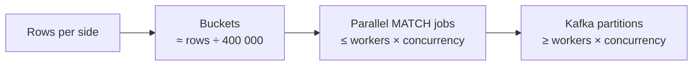

# 6. Operations guide

**Summary.** reconArk is five Spring Boot services, an nginx-served UI, PostgreSQL and Kafka. Run it with docker
compose on one machine, or with one Helm chart on Kubernetes. Scale by adding workers. Watch the Grafana dashboard;
four Prometheus alerts tell you when something needs attention, and section 6.5 says what to do for each.

## 6.1 Deploy

### Single machine (test, demo)

```bash
cd code
deploy/start.sh                                                          # build + start
docker compose -f deploy/docker-compose.yml --profile app ps             # status
docker compose -f deploy/docker-compose.yml --profile app logs -f worker # logs
docker compose -f deploy/docker-compose.yml --profile app up -d --scale worker=4
docker compose -f deploy/docker-compose.yml --profile app down           # stop (data kept in volumes)
docker compose -f deploy/docker-compose.yml --profile app down -v        # stop and delete all data
```

### Kubernetes (Helm)

Prerequisites, provided by your platform team or cloud:

| Need | Example |
|---|---|
| PostgreSQL 16+ (18 recommended), highly available, backed up | AWS RDS / Aurora, Azure Database for PostgreSQL, Cloud SQL |
| Kafka 3.6+ with 3 brokers | Amazon MSK, Confluent Cloud, Event Hubs (Kafka API), Strimzi on Kubernetes |
| A `ReadWriteMany` volume claim named `reconark-files` | EFS, Azure Files, Filestore, NFS |
| A Secret `reconark-db` with key `password` | `kubectl create secret generic reconark-db --from-literal=password=…` |
| Images in a registry | build with the Dockerfiles in `code/deploy/docker`, push to your registry |
| Prometheus + Grafana | kube-prometheus-stack; pods carry `prometheus.io/*` annotations; import `deploy/grafana/dashboards/reconark.json` |

Install one release per service (from `code/`):

```bash
for svc in config-service ingestion-service manager report-service worker frontend; do
  helm upgrade --install $svc deploy/helm/reconark-service -f deploy/helm/values/$svc.yaml -n reconark
done
```

Edit the values files for your hostnames (`DB_URL`, `KAFKA_BOOTSTRAP_SERVERS`) and image registry. Put an Ingress with
TLS (and, before production, single sign-on) in front of the `frontend` service. Set
`RECONARK_KAFKA_REPLICAS=3` on the manager and workers so topics are replicated.

### Start-up order

The manager creates the engine tables, so on a fresh database start it before report-service and workers (they retry
until it is there). Everything else can start in any order.

## 6.2 Configuration

All settings are environment variables; the full list is in the
[LLD configuration reference](03-detailed-design.md#38-configuration-reference). The ones operations usually change:

| Variable | Service | Typical production value |
|---|---|---|
| `DB_URL`, `DB_USER`, `DB_PASSWORD` (from a Secret) | all | managed PostgreSQL |
| `KAFKA_BOOTSTRAP_SERVERS` | manager, worker | managed Kafka |
| `RECONARK_MANAGER_BUCKETCOUNT` | manager | see sizing below |
| `RECONARK_MANAGER_JOBTIMEOUT` | manager | longer than your slowest LOAD job, e.g. `30m` |
| `RECONARK_KAFKA_PARTITIONS` / `RECONARK_KAFKA_REPLICAS` | manager, worker | 24–48 / 3 (only used when topics are created) |
| `RECONARK_WORKER_CONCURRENCY` | worker | 2–4 per CPU core given to the worker |
| `RECONARK_PLUGINS_<NAME>_ENABLED` | any | `false` to switch a plugin off (dashes removed: `FORMATFIXEDWIDTH`) |
| `frontend public/config.json` | frontend | which screens to show; Grafana/Prometheus links |

## 6.3 Sizing and scaling



| Rows per side | Buckets (`BUCKETCOUNT`) | Workers × concurrency | Jobs topic partitions | Worker memory |
|---|---|---|---|---|
| up to 1 M | 16 | 2 × 2 | 12 | 1 GB |
| 10 M | 64 | 4 × 2 | 12 | 2 GB |
| 100 M | 256 | 8–12 × 2 | 24 | 4 GB |

Rules of thumb:
- **Buckets:** a MATCH job holds one bucket in memory. Keep each bucket under ~1 million records
  (`2 × rows ÷ buckets`).
- **Partitions:** one partition feeds one consumer thread. Partitions must be ≥ workers × concurrency, or extra
  workers sit idle. Partitions are set when the topic is created (`kafka-topics.sh --alter` to add more later).
- **Workers:** scale on CPU (the Helm values enable a HorizontalPodAutoscaler 3–12) or on Kafka lag (KEDA, roadmap).
- **Database:** loading is insert-heavy. Give PostgreSQL fast storage; keep `max_connections` ≥ total pool size
  (10 per worker, 10 per service).
- **Loading one file** is done by one worker. If a single file is the bottleneck, see roadmap R6.

## 6.4 Monitoring and alerts

Grafana dashboard **reconArk** (home page of the bundled Grafana):

| Row | Panel | Healthy looks like |
|---|---|---|
| Runs | Runs started / completed / failed | failed = 0 |
| | Runs in progress, jobs waiting | goes up during a run, back to 0 after |
| | Workers up | = the number you deployed |
| | Average run duration | stable for the same volume |
| Workers | Records loaded per second | steady during LOAD |
| | Results per second by status | spikes during MATCH |
| | Rejected rows per second | 0 or a small, explainable number |
| | Average job duration, failed jobs | no failures |
| | Kafka consumer lag | returns to 0; constantly growing = add workers |
| Services | HTTP requests and 5xx errors | 5xx ≈ 0 |
| | JVM heap, DB connections, CPU | below limits |

Logs: every service logs to stdout (collect with your platform's log stack). Each job logs its start, end, duration
and counts with the run id and job id, so `grep <run-id>` across services tells the story of a run.

## 6.5 Alert runbook

| Alert | Meaning | What to do |
|---|---|---|
| **ReconRunFailed** | A run ended FAILED in the last 10 minutes | Open the run in the UI: the error says which job failed and why. Bad file → fix the file or definition and start a new run. Infrastructure error (database, storage) → fix it, then start a new run |
| **NoWorkersRunning** (critical) | No worker is up for 2 minutes | `kubectl get pods -l app.kubernetes.io/name=worker` / `docker compose ps worker`; check logs for start-up errors (database or Kafka unreachable, out of memory) |
| **JobsNotMoving** | Jobs are waiting but nothing finished in 15 minutes | Kafka UI → consumer group `recon-workers`: are workers connected? Lag growing? Check worker logs for long-running or stuck jobs; check database load |
| **JobsFailing** | Workers keep reporting failures | Worker logs (search `failed after`); common causes: storage folder not shared, database full, malformed files |

## 6.6 Routine tasks

| Task | How |
|---|---|
| Back up | PostgreSQL is the only state that matters (files can be uploaded again). Use your managed service's automated backups + point-in-time recovery |
| Clean up old results | Until the retention job exists (roadmap R9): `delete from engine.recon_run where finished_at < now() - interval '180 days';` (jobs cascade) and `delete from engine.recon_result where run_id not in (select id from engine.recon_run);` |
| Clean up old files | Delete files older than your retention from the storage folder |
| Upgrade | Build new images, `helm upgrade` each service. Database migrations run automatically at start-up. Workers can be upgraded while runs are in progress (jobs are retried) |
| Add a plugin | Deploy new worker and config-service images that contain it; no database change |

## 6.7 Troubleshooting

| Symptom | Check |
|---|---|
| Run stuck in LOADING or MATCHING | Run page → Jobs: which are QUEUED, how many attempts? Kafka UI lag. Worker logs |
| Many rejected rows | Field mapping or match fields don't match the file's columns (column names are case-sensitive) |
| Everything ONLY_IN_LEFT / ONLY_IN_RIGHT | Match keys differ in format (leading zeros, spaces inside, different reference fields): map the right columns, or add a normalising plugin (roadmap R13) |
| Report download slow or times out | Increase the proxy timeout (nginx `proxy_read_timeout`, ingress annotations); point report-service at a read replica |
| `OutOfMemoryError` in a worker | Too few buckets for the volume: raise `BUCKETCOUNT` or the worker's memory |
