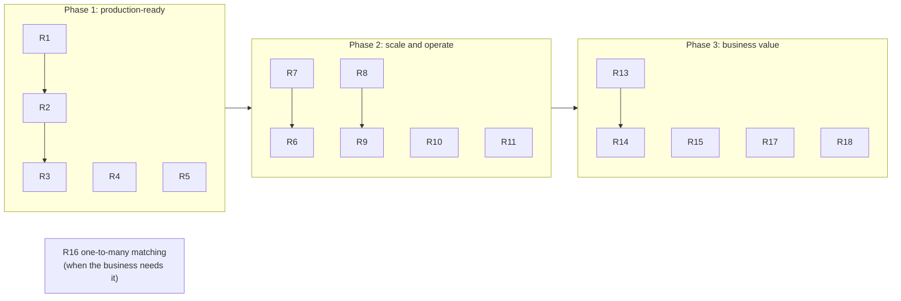

# 7. Roadmap and recommended enhancements

**Summary.** This version is a clean, working, scalable base. Before real customer data goes through it, add
security and cloud storage (R1–R5). Then make it production-strong (R6–R12) and richer for the business (R13–R19).
Each item says what, why, and roughly how much work.

Effort: **S** = days, **M** = 1–3 weeks, **L** = a month or more (for one developer who knows the code).

## 7.1 Before production (must have)

| # | Enhancement | Why | How | Effort |
|---|---|---|---|---|
| R1 | **Single sign-on** | Nobody should reach the data anonymously | OIDC (Keycloak, Entra ID, Okta). Simplest: an `oauth2-proxy` or the ingress in front of nginx. Cleaner: each service becomes an OAuth2 resource server (`spring-boot-starter-security-oauth2-resource-server`) and the UI logs in with a backend-for-frontend | M |
| R2 | **Roles and maker-checker** | Separation of duties, audit requirement in finance | Roles `viewer`, `analyst`, `admin`; definitions get statuses DRAFT → SUBMITTED → APPROVED, and the approver must be a different person; only APPROVED definitions can run | M |
| R3 | **Audit trail** | Who changed which definition, who started which run, who downloaded what | An `audit` table written in the same transaction as each change; a read-only Audit UI module | S–M |
| R4 | **TLS and secrets everywhere** | Data in transit and passwords | TLS on ingress, Kafka (SASL/SSL), PostgreSQL (`sslmode=verify-full`); secrets from the cloud secret manager via External Secrets Operator | S |
| R5 | **Object-storage plugin** | Shared volumes are awkward in the cloud | `storage-s3` (works with AWS S3, MinIO, and S3-compatible stores), `storage-azure-blob`, `storage-gcs`: each one `FileStore` class | S per cloud |

## 7.2 Production strength (should have)

| # | Enhancement | Why | How | Effort |
|---|---|---|---|---|
| R6 | **Split large files** | One LOAD job per file limits loading of a 50 GB file to one worker | Ingestion records byte offsets of line starts every N MB; the manager creates one LOAD job per chunk | M |
| R7 | **Faster loading with `COPY`** | Batched inserts reach ~50–100 k rows/s per worker; PostgreSQL `COPY` is 3–5× faster | Use the PostgreSQL driver's `CopyManager` in `RecordStore.insert` | S |
| R8 | **Partition the big tables** | Deleting staging rows and old results of a run becomes instant (drop a partition) | `LIST` partitioning of `recon_record` and `recon_result` by run, or `RANGE` by date | M |
| R9 | **Retention job** | Results grow forever | A scheduled job in the manager deletes runs older than a configured age (or drops partitions, with R8) | S |
| R10 | **Autoscale workers on Kafka lag** | CPU is a poor signal for a queue | KEDA `ScaledObject` on consumer group `recon-workers` | S |
| R11 | **Read replica for reports** | Large downloads shouldn't slow loading | Point report-service's `DB_URL` at a replica | S |
| R12 | **Contract tests and API docs** | Keep UI and services in step | springdoc-openapi generates OpenAPI from the controllers; publish it; generate TypeScript types from it | S |

## 7.3 Business features (could have, in a sensible order)

| # | Enhancement | Why | How | Effort |
|---|---|---|---|---|
| R13 | **Normalising field rules** | Real keys differ in format: leading zeros, spaces, prefixes | A new plugin kind `FieldNormaliser` (trim, upper-case, strip-leading-zeros, regex replace) applied before the match key is built | S–M |
| R14 | **Exception workflow** | Analysts need to assign, comment and close mismatches | An `exception-service`: each non-MATCHED result becomes a case (open → assigned → resolved), with comments and a UI module | L |
| R15 | **Scheduling and automatic ingestion** | Files arrive daily on SFTP or in a bucket | A `SourceConnector` plugin kind (SFTP, S3 event, API); a scheduler that starts runs when both files have arrived | M |
| R16 | **One-to-many and many-to-many matching** | One bank payment settles several invoices | A `MatchStrategy` plugin kind: group by key, compare sums; needs a richer result model | L |
| R17 | **More formats and reports** | Partners send Excel, XML (ISO 20022 camt.053), JSON | More `FileFormat` and `ReportWriter` plugins (Excel report via Apache POI) | S each |
| R18 | **Notifications** | Tell people when a run finishes or fails | A `Notifier` plugin kind (e-mail, Teams, Slack) called by the manager | S |
| R19 | **Data masking** | Card numbers, IBANs should not be shown in full | A masking option per field in the definition, applied by report-service | S |

## 7.4 Suggested sequence

## 7.5 Questions to settle with the business

| Question | Why it matters |
|---|---|
| Which reconciliations come first, with which partners and formats? | Decides which format plugins (R17) and connectors (R15) to build |
| Who may create, approve and run definitions? | Roles and maker-checker design (R2) |
| How long must results be kept? | Retention (R9) and storage sizing |
| What volumes and deadlines per run? | Sizing, and whether R6/R7 are needed early |
| Which cloud, Kafka and PostgreSQL offering? | Deployment values, storage plugin (R5) |
| Which fields are sensitive? | Masking (R19), logging rules |
