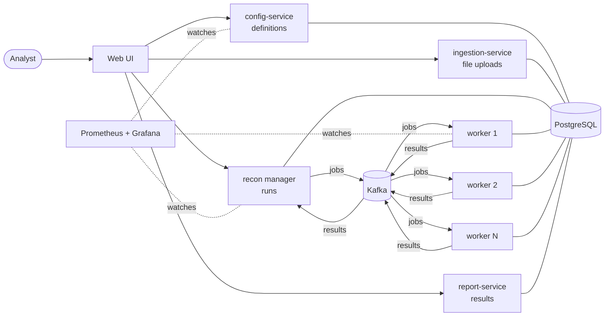

# reconArk documentation

Read the documents in order. Each one starts with a short summary, so you can stop when you have what you need.

| # | Document | What it answers | Read it if you are |
|---|---|---|---|
| 1 | [Business overview](01-business-overview.md) | What does reconArk do? What do the words mean? What does a user see? | Everyone: business consultants start and often finish here |
| 2 | [Architecture (C4 + HLD)](02-architecture.md) | Which parts exist, how do they talk, why this technology? | Developers, architects, testers, operations |
| 3 | [Detailed design (LLD)](03-detailed-design.md) | Tables, APIs, messages, state machines, the matching algorithm | Developers, testers |
| 4 | [Developer guide](04-developer-guide.md) | How do I run it, find my way in the code, and add a plugin, service or screen? | Developers |
| 5 | [Testing guide](05-testing-guide.md) | What is tested automatically, and what test cases do I run by hand? | Testers, developers |
| 6 | [Operations guide](06-operations-guide.md) | How do I deploy, configure, scale and monitor it, and what do I do when an alert fires? | Operations, developers |
| 7 | [Roadmap and enhancements](07-roadmap.md) | What should be added before production, and after? | Sponsors, architects, product owners |
| — | [Decisions](decisions/README.md) | Why we chose what we chose (one page per decision) | Anyone asking "why?" |

## The system in one picture



## Repository layout

```
reconArk/
├── docs/            ← you are here: design and documentation
└── code/            ← all source code, one Gradle build + one npm project
    ├── backend/       common model, plugins ("Lego bricks"), business microservices
    ├── recon-engine/  distributed engine: manager + workers
    ├── frontend/      React web UI with switchable modules
    └── deploy/        docker compose, Helm, Prometheus, Grafana, sample data
```

The previous, more complex design (plugin kernel, 11 services, 37 decision records) is kept on the Git branch
`archive/v0.2` for reference. This version replaces it.

## Keeping the docs right

- Diagrams are [Mermaid](https://mermaid.js.org/) inside the Markdown, so GitHub draws them and they change with the
  text. CI checks that every diagram parses (`docs/_lint`).
- When code changes behaviour that a document describes, change the document in the same pull request.
